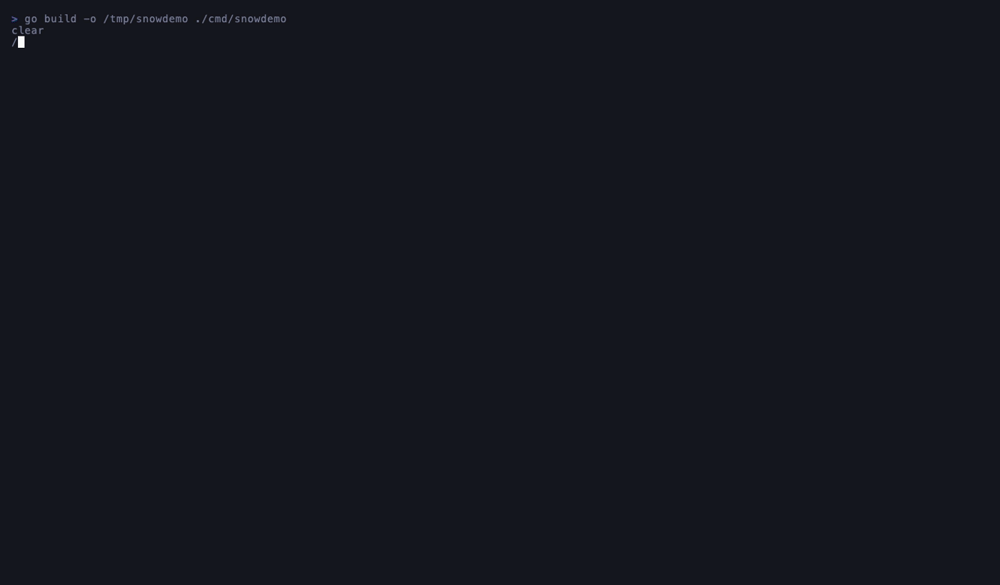
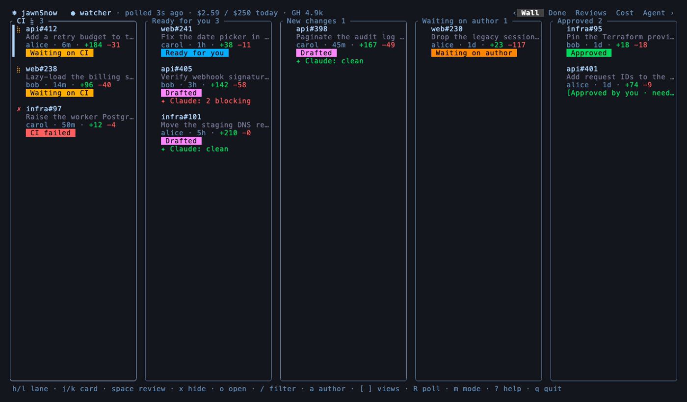
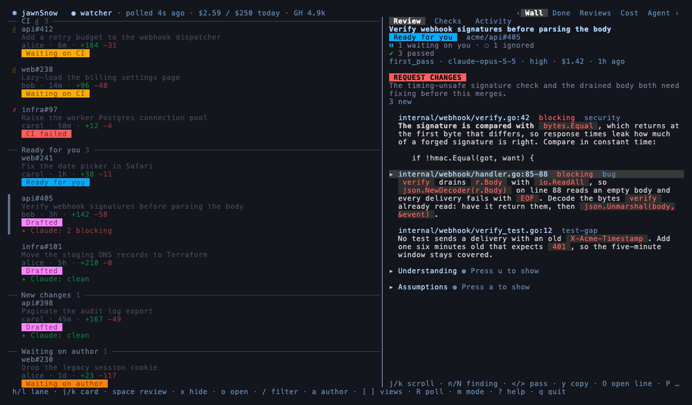
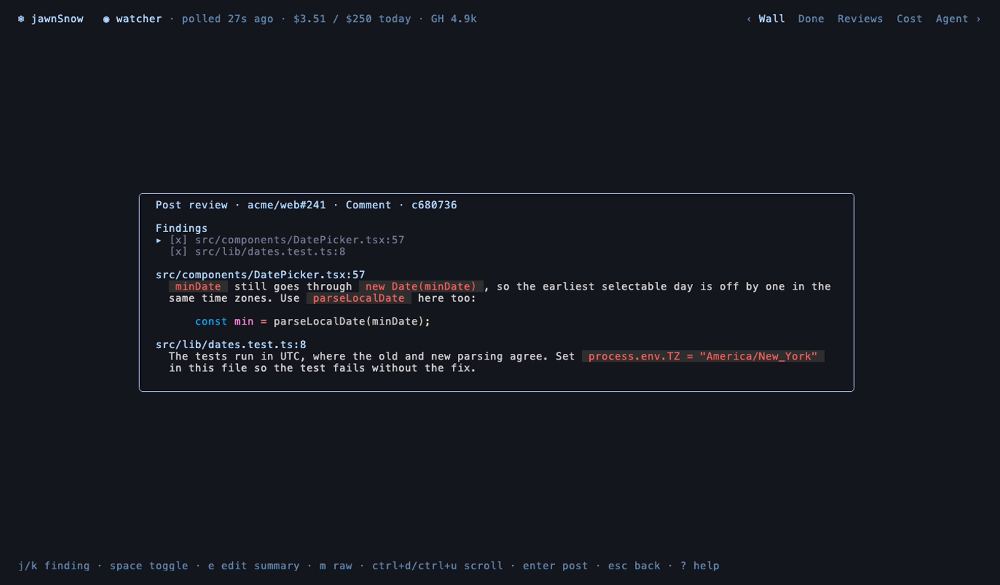
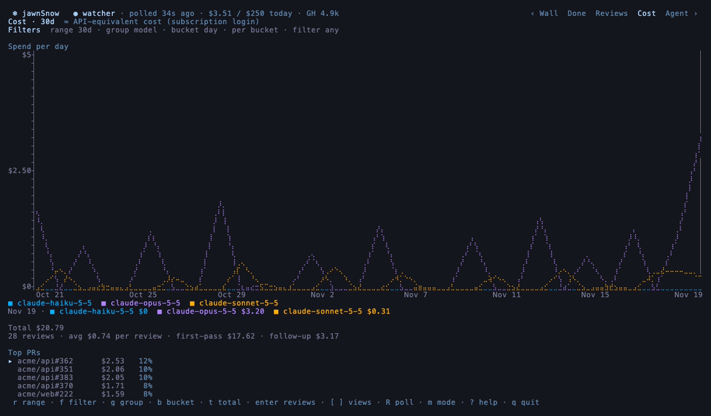

# jawnSnow

`snow` is a terminal UI that watches the GitHub PRs your team asks you to review, shows each PR's status, runs read-only Claude reviews, and lets you post a review you've read as your own after a preview.

[What it does](#what-it-does) · [Requirements](#requirements) · [Install](#install) · [Quickstart](#quickstart) · [Screenshots](#screenshots) · [Configuration](#configuration) · [Documentation](#documentation) · [Development](#development) · [Credits](#credits) · [License](#license)



## What it does

- The Wall sorts each open PR into one lane: CI, Ready for you, New changes, Waiting on author or Approved. Merged and closed PRs move to the Done view.
- Watcher mode polls and shows statuses, and reviews run only when you press `space`. Auto mode also queues reviews in the background, within a daily budget.
- Claude reviews open in a drawer next to the Wall. The reviewer can only read files (`Read`, `Grep`, `Glob`): no shell, no network, and no settings, hooks or MCP servers from the PR's checkout.
- A review reaches GitHub only when you press `P`, pick Approve, Comment or Request changes, and confirm the preview.
- The Cost view charts spend over 7, 30 or 90 days or a custom range, grouped by model, author, repo or tier.
- The Reviews view lists reviews, newest first, with each one's outcome, verdict, findings and cost.

## Requirements

- Go 1.27 or later.
- The GitHub CLI, logged in with `gh auth login`.
- For reviews, `git` and the `claude` CLI, logged in. Without `claude`, snow runs in watcher mode only.

## Install

```sh
go install github.com/chrisdaly-3/jawnsnow/cmd/snow@latest
```

Or from a clone of [github.com/chrisdaly-3/jawnsnow](https://github.com/chrisdaly-3/jawnsnow):

```sh
git clone https://github.com/chrisdaly-3/jawnsnow.git
cd jawnsnow
go install ./cmd/snow
```

## Quickstart

Run `snow`. The first run writes `~/.config/jawnsnow/config.toml` with commented defaults, which watch the open PRs where your review is requested. `snow config default` prints the same defaults.

The keys to start with:

| Key | Does |
| --- | --- |
| `?` | Show or hide help for the current view |
| `[` `]`, `1`-`5` | Previous or next view, or jump to one |
| `h` `l`, `j` `k` | Move between lanes and cards |
| `enter` | Open the review drawer |
| `tab` | Move focus, such as into the drawer |
| `space` | Review the PR with Claude now |
| `P` | Post the drawer's review, after a preview |
| `R` | Poll now |
| `m` | Switch between watcher and auto mode |
| `q` | Quit |

## Screenshots

| | |
| --- | --- |
|  |  |
| The Wall, with CI still running on two PRs. | A review in the drawer, with two blocking findings. |
|  |  |
| The preview of a review about to be posted as a comment. | A month of spend, grouped by model. |

The demo and screenshots use made-up PRs.

## Configuration

Every option is commented in `~/.config/jawnsnow/config.toml`, and snow reloads the file when you save it. `snow config default` prints the defaults. Guides to the options will live in [`docs/`](docs/).

## Documentation

[`docs/`](docs/) holds the demo recording, and the guides once they are written.

## Development

Run the tests:

```sh
go test ./...
```

Regenerate the demo GIF and screenshots, which needs `vhs`, `ttyd` and `ffmpeg`:

```sh
vhs docs/demo/demo.tape
```

The tape records `cmd/snowdemo`, which runs the interface over fake data in a temporary directory. `go run ./cmd/snowdemo` opens it directly.

## Credits

Review prompt adapted from Dispatch (github.com/kbsteere/dispatch), MIT. The notice is in [`internal/review/prompt/LICENSE-dispatch`](internal/review/prompt/LICENSE-dispatch).

## License

MIT. See [`LICENSE`](LICENSE).
