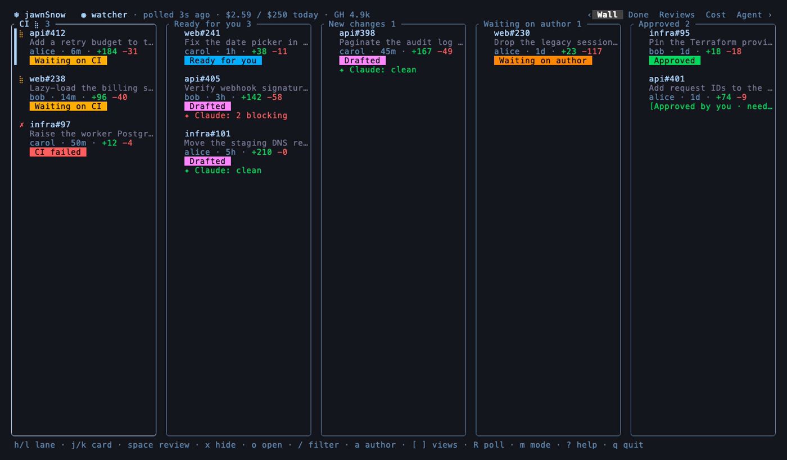
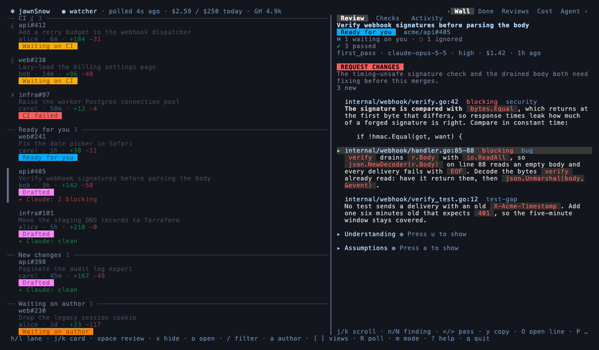

# Getting started

This page takes you from installing snow to your first Claude review.

## Prerequisites

- Go 1.27 or later, to build snow.
- The GitHub CLI, logged in. Run `gh auth login`. snow uses the same login to read PRs and, when you choose to post, to post reviews. It needs no token of its own.
- `git`, for reviews. snow fetches PRs and makes worktrees with it.
- The `claude` CLI (Claude Code), on your `PATH` and logged in, for reviews. Check with `claude auth status`. Without it snow still runs, in watcher mode, and shows `reviews off: <reason>`.

## Install

```sh
go install github.com/chrisdaly-3/jawnsnow/cmd/snow@latest
```

Or from a clone:

```sh
git clone https://github.com/chrisdaly-3/jawnsnow.git
cd jawnsnow
go install ./cmd/snow
```

Both put `snow` in `$(go env GOPATH)/bin` (or `$GOBIN`). The commands:

| Command | Does |
| --- | --- |
| `snow` | start the interface |
| `snow config default` | print the commented default config |
| `snow config path` | print the config file snow reads, or would create |
| `snow version` | print the version |
| `snow help` | print the usage |

## The first run

Run `snow`. On the first run it writes the commented defaults to `~/.config/jawnsnow/config.toml` (or under `$XDG_CONFIG_HOME`; see [configuration.md](configuration.md#the-config-file)) and shows:

```
Created ~/.config/jawnsnow/config.toml with the defaults — edit it any time; snow reloads on save.
```

You don't need to edit anything to start. The banner goes away the first time snow reloads the file after you save it. snow also makes its data directory, `~/.local/share/jawnsnow` (or `$XDG_DATA_HOME/jawnsnow`), for its database, clones and worktrees; see [files.md](files.md).

At startup snow checks the `gh` login and runs `claude --version` and `claude auth status`. If something is missing, a banner says what. The two you are most likely to see:

- `⚠ No gh login found — snow can't poll GitHub or run reviews. Run "gh auth login", then restart snow.`
- `reviews off: claude not found on PATH`, or `reviews off: claude is not logged in — run "claude auth login"`.

## Feeds

A feed is a GitHub search. snow runs each feed's search every poll (every 3 minutes by default), and every PR any feed finds goes on the Wall. The default config has one feed:

```toml
[[feeds]]
name = "review-requested"
query = "is:pr is:open review-requested:@me"
since = "14d"
```

That finds open, non-draft PRs where your review is requested and that were updated in the last 14 days. Once found, a PR stays on the Wall after GitHub drops the request (as it does when you review), until it merges, closes, goes stale (no update for 14 days) or you hide it.

To follow more, add feeds. Adding any `[[feeds]]` block replaces the default, so keep it if you want it:

```toml
[[feeds]]
name = "review-requested"
query = "is:pr is:open review-requested:@me"

[[feeds]]
name = "my-team"
query = "is:pr is:open team-review-requested:my-org/my-team"
team = true
```

Save the file and snow uses the new feeds at the next poll. Press `R` to poll now. [configuration.md](configuration.md#feeds) covers every feed setting.

## The Wall

The Wall is the first view. Each open PR is a card in one of five lanes, by status: CI, Ready for you, New changes, Waiting on author, and Approved.



A card shows the repo and number, the title, the author, how old the head commit is, the lines added and removed, the status chip, and a Claude badge once a review exists. The top line shows the mode, when snow last polled, today's review spend, and how much of your GitHub rate limit is left.

Move with `h` and `l` between lanes and `j` and `k` between cards. `o` opens the PR in your browser. `x` hides it (it moves to the Done view until there is new activity). `/` filters by text and `a` by author. `?` shows every key. [views.md](views.md#the-wall) explains lanes, statuses and badges.

## Your first review

1. Select a PR on the Wall and press `space`. The card's badge changes to `Claude reviewing…`.
2. Press `enter` to open the drawer beside the Wall. Focus moves into it, and `tab` moves focus back to the Wall. While the review runs, the drawer's bottom line shows what the reviewer is reading.
3. When it finishes, the badge shows `✦ Claude: clean` or `✦ Claude: 2 blocking`, and the drawer shows the verdict, the findings and the cost. `n` and `p` step through findings; `u` and `a` show the reviewer's understanding of the change and its assumptions.



Until you have reviewed a PR on GitHub, its reviews use the first-pass model, `claude-opus-5-5` at `high` effort, capped at $15 each. After that they use the follow-up model, `claude-sonnet-5-5` at `medium`. To pick another model for one review, press `c` instead of `space`.

Nothing goes to GitHub. To post the review as your own, press `P` in the drawer and follow the preview; [posting.md](posting.md) walks through it.

If the repo is large and you have a clone of it, point snow at it so it doesn't make its own:

```toml
[repos."my-org/service"]
path = "~/code/service"
```

snow only adds its own refs and worktrees to that clone; [files.md](files.md#what-snow-does-to-a-mapped-repo) lists exactly what it does.

## Watcher and auto mode

snow starts in watcher mode: it polls and shows statuses, and reviews run only when you press `space`. Press `m` to switch to auto mode for the session. Auto mode also reviews PRs in the background when they are ready for you (or have new commits since your review) and CI is green, after their head has been unchanged for 5 minutes. It reviews each head commit once, at most 4 times per PR per day, and pauses when the day's spend reaches $250.

To start in auto mode every time, set:

```toml
[mode]
default = "auto"
```

[reviews.md](reviews.md#watcher-mode-and-auto-mode) has every rule.

## Next

- [keys.md](keys.md): every key, by view.
- [views.md](views.md): the Wall, Done, Reviews, Cost and Agent views, the drawer, and every banner.
- [reviews.md](reviews.md): what triggers a review, what the reviewer reads and can do, and how cost is counted.
- [posting.md](posting.md): posting a review to GitHub.
- [configuration.md](configuration.md): every option.
- [troubleshooting.md](troubleshooting.md): when something looks wrong.
