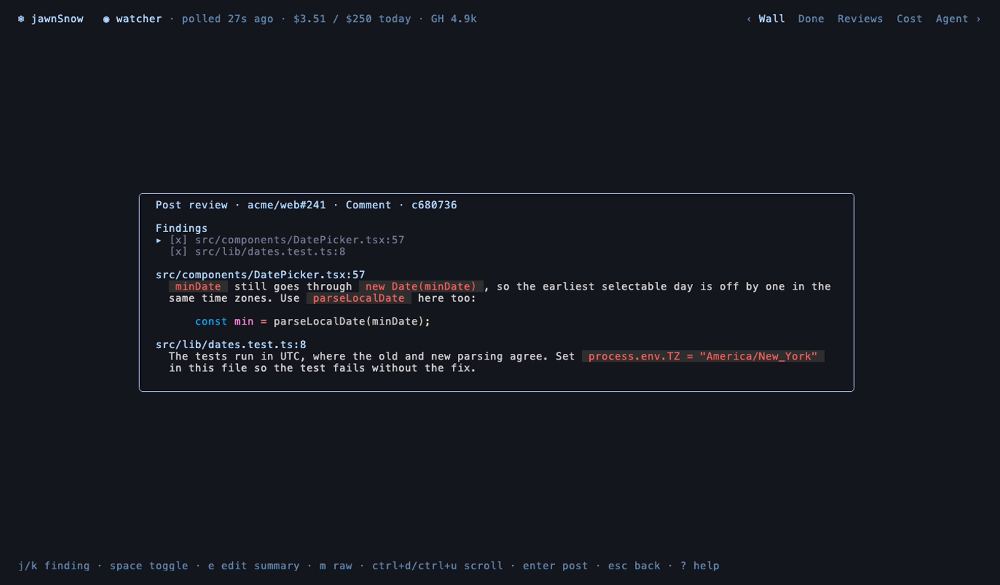

# Posting a review

Posting is the only thing snow writes to GitHub, and it happens only when you ask. `P` in the drawer opens the post flow on the pass on screen. You pick the review event, choose which findings to include, write a summary if you want one, check a preview of exactly what will be sent, and confirm. The review then goes to GitHub as one review under your `gh` login.



## Opening the flow

Open the drawer on a PR (`enter`), move focus into it (`tab`), go to the pass you want with `<` and `>`, and press `P`.

- A failed review can't be posted: the drawer says `a failed review can't be posted`. Complete and incomplete reviews can.
- When posting isn't available, `P` shows `posting unavailable: <reason>`. The reasons are `gh is not logged in`, `could not set up posting: <error>`, and `another snow is running on this machine — post from that window`.

The modal's title is `Post review · owner/name#number`. snow first checks the database for earlier posts of this review (`Checking earlier posts…`).

## The repost question

If this review was posted before, the flow asks first:

```
Already posted as Comment 3m ago — post again? y/n
```

If a post may have reached GitHub without snow recording it (see [Failures](#failures)), it asks:

```
A post may already have reached GitHub just now — post again? y/n
```

`y` goes on; `n` or `esc` closes the flow. Posting the same review twice makes two GitHub reviews, so check the PR first when you aren't sure.

## Picking the event

Three events are offered:

| Label | GitHub event |
| --- | --- |
| `Approve` | `APPROVE` |
| `Comment` | `COMMENT` |
| `Request changes` | `REQUEST_CHANGES` |

The cursor starts on the one that matches the reviewer's verdict (`approve`, `request_changes`, anything else `Comment`). The verdict only sets where the cursor starts. `j` and `k` move, `enter` picks and opens the preview, `esc` closes the flow.

## The checklist

The preview starts with `Findings`, a checklist of every finding in the review in the drawer's order, each with its location:

```
Findings
▸ [x] internal/store/store.go:88
  [x] internal/store/store.go:120-131
  [ ] internal/api/handler.go:41  [fixed]
  [x] internal/api · unanchored
  [ ] cmd/server/main.go:12  [posted]
```

`j` and `k` move the cursor and `space` checks or unchecks the finding under it. Every finding starts checked except:

- findings marked `[fixed]` (addressed) or `[answered]` by this pass's ledger;
- findings that were already posted as a GitHub thread, marked `[posted]`.

This keeps a follow-up from posting a point twice. Unanchored findings are posted in the summary, not as threads, so snow can't tell later that one was posted: an outstanding unanchored finding starts checked again in the next pass's post flow.

## The summary

The summary is the review's body. It starts empty, since it is your own text: the reviewer's understanding and its reason for the verdict stay private unless you copy them in.

`e` writes the current summary to a temporary file, `tmp/post-<review id>.md` in the data directory, readable only by you, and opens it in `$VISUAL`, else `$EDITOR`, else `vi`. The value is split on spaces and run without a shell, so `code -w` works. When the editor exits, snow reads the file back, trims trailing newlines, and deletes the file.

The checked unanchored findings are added to the body after a bold `**Other notes**` line, one list item per finding, each starting with its path in code formatting. They come after your text, or make up the whole body when you wrote none.

Rules on the body:

- Request changes needs your own summary: an empty one shows `Request changes needs a summary — press e to write one`, and `enter` does nothing.
- A Comment needs something to post, a body or at least one checked anchored finding: otherwise `nothing to post: write a summary or select a finding`.
- An Approve can be empty: the preview then says `No summary or comments: only the event is posted.`

## The preview

Below the checklist the preview shows every part that will be sent, in order: `Summary` (when the body isn't empty), then each inline comment labelled with its location (`internal/store/store.go:88` or `internal/store/store.go:120-131`). Each part is drawn from the exact string in the request, so what you see is what is sent.

The parts are rendered as markdown in glow's style (`theme.markdown` picks dark or light). `m` switches to the raw markdown and back; in the raw view tabs show as spaces. `ctrl+d` and `ctrl+u` scroll half a screen.

The preview's top lines:

- `Post review · owner/name#number · <event> · <commit>`, the short ID of the commit the review is of, which is the one it will be posted against.
- `PR has new commits since this review — comments will show as outdated`, when the PR's head has moved since the review.
- `Rendered view hides: <part>: <kinds> — press m to see the raw text`, when the rendered view hides or acts on something. The kinds are:
  - `encoded control character`: a character reference such as `&#27;` that decodes to a control or invisible character;
  - `HTML comment`;
  - `raw HTML`;
  - `image`;
  - `link reference (renders as nothing)`: a link reference definition;
  - `mentions @alice, @org/team`: mentions, which notify those people when posted.
- An error from building the review or from a failed post, in the failure colour.

Before anything is shown or sent, snow strips control characters (other than newlines and tabs), terminal escape sequences, and zero-width and bidirectional formatting characters from every part, and replaces character references that decode to one of those with `�`.

`esc` goes back to the event picker, keeping your checklist and summary.

## Confirming

`enter` in the preview posts. Two rules stop an accidental post:

- `enter` only counts when the preview has been unchanged for at least 500 ms: since it opened, since you toggled a finding, and since the editor closed. An earlier `enter` restarts the wait and the footer shows `hold on — press enter again to post`.
- Holding a key down doesn't post. snow ignores key repeats in the flow, and on terminals that send a held key as plain presses each one restarts the 500 ms wait.

While the post is sent, the preview shows `Posting to GitHub…` and ignores every key but `ctrl+c`. The first `ctrl+c` warns `posting to GitHub — ctrl+c again to quit anyway`, since a post can't be taken back once sent.

Just before sending, snow reads the review's posts again. If one was recorded since the flow opened, nothing is sent and the repost question comes back.

## What is sent

One `addPullRequestReview` GraphQL mutation, with every value passed as a variable:

| Field | Value |
| --- | --- |
| `pullRequestId` | the PR |
| `commitOID` | the head commit the review is of, even when the PR has moved on |
| `event` | `APPROVE`, `COMMENT` or `REQUEST_CHANGES` |
| `body` | your summary and the "Other notes" |
| `threads` | one per checked anchored finding: `path`, `line`, `side: RIGHT` and `body`, plus `startLine` and `startSide: RIGHT` for a range |

Inline comments go on the new (`RIGHT`) side of the diff, at the lines the review found. A review of an older commit is still posted against that commit, so GitHub shows its inline comments as outdated. The mutation is never retried: a retry after a lost response could post the review twice.

Posted reviews carry no footer or "reviewed with" line.

## After posting

When GitHub accepts the review:

1. snow records the post in its database straight away: the GitHub review ID and URL, the event, the commit, which findings were included, and the time.
2. It looks up the review threads GitHub made for the inline comments and stores each thread's ID on its finding.
3. It polls at once, so the PR's status catches up. A posted approval or change request, or a comment with a summary or at least one inline comment that starts a thread, is your review on GitHub: the PR moves lanes, and the next Claude review uses the `follow_up` tier.

The drawer then shows `Posted as Comment · just now` on that pass, and the Reviews view shows `✓`. The next pass gets the posted findings with their thread IDs, so it can read the author's replies in those threads and mark a finding answered. See [the ledger](reviews.md#the-earlier-findings-ledger).

If the thread lookup fails, the post still stands and snow shows `posted, but could not look up its threads: <error>`. Those findings then don't count as posted for the checklist or the ledger.

## Failures

What snow does depends on whether the review might have reached GitHub.

- Refused: GitHub answered with errors and no review, or with an HTTP 4xx, or snow refused the request before sending it. Nothing was posted. The preview shows `post failed: <error>` and keeps your choices, and you can fix the problem and press `enter` again.
- Unknown: a timeout, a 5xx, a lost connection, or a response with no review in it. The review may have been posted. The preview shows `the post may have reached GitHub — check the PR before posting again: <error>`, and the next `enter` asks the repost question first. snow remembers this until you quit.
- Posted but not recorded: GitHub took the review but writing the record failed. The modal shows `posted to GitHub, but saving the record failed: <error> — <review URL>`; `esc` or `enter` closes it. For the rest of the session the drawer still shows the post and the flow still asks before reposting, but after a restart snow has no record of it.

If the flow was closed by the time the result arrived, these show as a notice instead.

## A second snow window

Only the snow that holds the data directory's lock can post. In a second snow on the same machine, `P` shows `posting unavailable: another snow is running on this machine — post from that window`. The guard against double posts reads both the database and the posting snow's memory (for posts that may have reached GitHub), so it only works from one process.

## Why snow never posts on its own

A posted review goes out under your name, and the reviewer reads text written by the PR's author, which could try to steer what it writes. So neither mode posts, nothing in the review pipeline can reach the one GitHub write, and every post goes through the preview and your `enter`. The reviewer is also told that a person reads what it returns and that it can't post anything.
