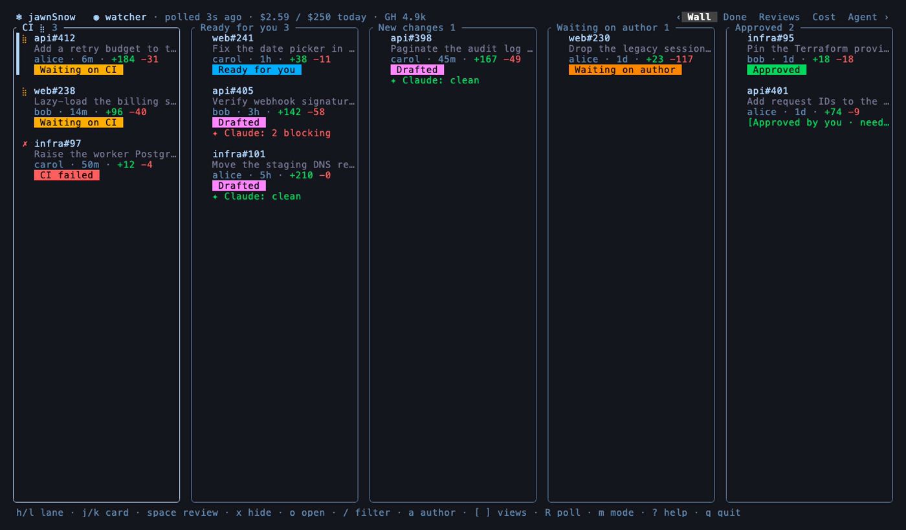
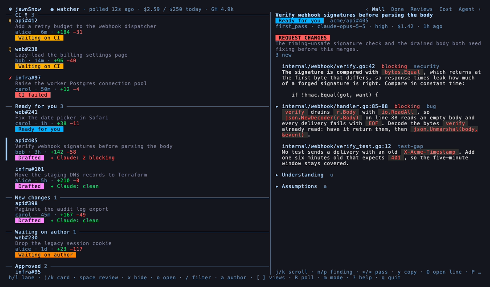
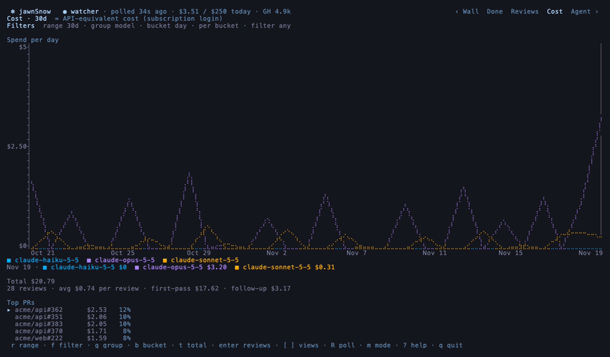

# Views

snow has five views: the Wall, Done, Reviews, Cost and Agent. The top line shows them as tabs, `‹ Wall  Done  Reviews  Cost  Agent ›`, with the current one in the accent colour. `[` and `]` cycle through them and `1` to `5` jump to one. The drawer opens beside the Wall, the Done view or the Reviews view. [keys.md](keys.md) lists every key.

## The status bar and banners

The top line reads, left to right:

```
 ❄ jawnSnow   ◉ watcher · polled 40s ago · $3.12 / $250 today · GH 4.6k   ‹ Wall  Done  Reviews  Cost  Agent ›
```

- `◉ watcher` or `◉ auto`: the mode.
- The poll state: `polling…` before the first poll finishes, `polled 40s ago` after a good poll, `not polling` with no `gh` login, `rate limited` when GitHub refused the last poll for rate limiting, or `poll failed: <error>` (cut to 60 characters) when it failed for another reason.
- Today's spend against `review.budget.daily_usd`. In auto mode, `· auto-review paused: daily budget` follows it once the budget is spent.
- `GH 4.6k`: the GitHub rate-limit points left, as GitHub last reported them, or `GH –` before the first report.

Banners are the lines under the top line. They show, in this order:

| Banner | Means |
| --- | --- |
| `⚠ No gh login found — snow can't poll GitHub or run reviews. Run "gh auth login", then restart snow.` | No GitHub token for github.com. snow shows the interface and stored data but can't poll, review or post. Always first, in the `CI_FAILED` colour. |
| `⚠ gh client failed: <error> — snow can't poll GitHub or run reviews. Run "gh auth login", then restart snow.` | A token was found but the GitHub client couldn't be built. |
| `⚠ GitHub rejected the gh login (401) — snow can't poll GitHub or run reviews. Run "gh auth login", then restart snow.` | GitHub answered a poll with 401. Polls keep their schedule, and the next good poll clears it. |
| `config: unknown key "<key>"` | An unknown key at startup. See [unknown keys](configuration.md#unknown-keys-and-errors). |
| `config reload is off: <error>` | snow couldn't watch the config directory. Edits need a restart. |
| `reviews off: <reason>` | Reviews can't run, so snow runs in watcher mode. The reasons are in [troubleshooting.md](troubleshooting.md#reviews-off). Not shown when the login warning is. |
| `auto mode unavailable — reviews off: <reason>` | The same, when `mode.default = "auto"`. snow starts in watcher mode. |
| `worktree cleanup: <error>` | The startup cleanup of worktrees and refs failed for a repo. Shown only when it finishes within 2 seconds of starting. |
| `could not load saved PRs: <error> — not saving this session` | The database read failed. snow polls but saves no PR changes until restart. |
| `config: XDG_CONFIG_HOME is not an absolute path ("<value>"), so it was ignored` | `XDG_CONFIG_HOME` is relative, so snow used `$HOME/.config` instead. See [configuration.md](configuration.md#the-config-file). |
| `Created ~/.config/jawnsnow/config.toml with the defaults — edit it any time; snow reloads on save.` | First run. The path shown is wherever the config was created. Cleared by the first good reload. |
| `No config at ~/.config/jawnsnow/config.toml — using defaults (could not create it: <error>). Run "snow config default" to start one.` | The default config couldn't be written. |
| `config error: <error> — using last good config` | A reload with a mistake. Cleared by the next good reload. |
| `config warning: unknown key "<key>"` | An unknown key found by a reload. |
| `GitHub rate limit low — resuming 14:05` | snow is waiting until that time to poll: GitHub refused a poll for rate limiting, or fewer than 200 points remain. |
| `GitHub rate limit getting low — polling slower` | Fewer than 1000 points remain, so snow polls at twice `github.poll_interval`. |
| `poll failed: all feeds failed (<errors>)` | Every feed's search failed and no tracked PR could be reached, as when an SSO session expires. The full error, which the top line cuts short. |
| `search feed "<name>": <error>` | One feed's search failed. The poll went on without it. Several are joined with `; `. |
| `1 PR unreachable (FORBIDDEN)`, `3 PRs unreachable (FORBIDDEN, NOT_FOUND)` | GitHub answered these tracked PRs with an error. They keep their last status until a poll reaches them. |
| a notice | The latest one-line notice from an action, such as `review queued: 2 already running` or `could not open the browser: <error>`. It stays until another notice replaces it. |

[troubleshooting.md](troubleshooting.md) says what to do about each.

## The Wall

The Wall is the landing view: every open PR snow tracks, as a card in one of five lanes.



| Lane | Statuses |
| --- | --- |
| CI | `CI_WAITING`, `CI_FAILED` |
| Ready for you | `READY_FOR_REVIEW` |
| New changes | `NEW_CHANGES` |
| Waiting on author | `CHANGES_REQUESTED` |
| Approved | `APPROVED`, `APPROVED_BY_YOU` |

Each lane's title shows its card count, and a spinner when a card in it is spinning. Cards in a lane are ordered by when snow first saw their head commit, newest first.

When the Wall is 120 columns wide or more, the lanes sit side by side and each scrolls on its own. Narrower than that, they stack into one column with a heading per lane, and empty lanes are left out. The drawer takes its width from the Wall, so opening it can switch the Wall to the stacked layout.

With nothing on the Wall it says `Nothing on the wall. Feeds: <feed names> · press R to poll`. With filters that match nothing it says `No PRs match the filter.` The filters show on a line below the lanes, such as `filter: oidc · author: alice · esc clears`.

### Cards

A card has four lines:

```
 ⣾ mono#85180
   feat(policies): fill repo_name
   alice · 2h · +120 −8
   Waiting on CI  ✦ Claude: 2 blocking
```

1. A spinner while the status is in progress (or while a review runs, if the status has a spinner), or `✗` for CI failed; then the repo's short name and the PR number.
2. The title.
3. The author, the age of the head commit (`45m`, `2h`, `3d`), and lines added and removed.
4. The status chip, then the Claude badge. When both don't fit, the badge takes the chip's place.

The selected card has a bar in the accent colour on its left edge.

### The Drafted pill

A card shows `Drafted` in place of its status chip when the PR's latest Claude review is ready to post:

- it finished with outcome complete, not incomplete or failed;
- it is of the PR's current head commit;
- it has never been posted.

```
   api#405
   Verify webhook signatures before parsing the body
   bob · 3h · +142 −58
   Drafted  ✦ Claude: 2 blocking
```

The Claude badge stays beside it. The card stays in its lane: `Drafted` is not a status, so it changes no lane, count or Done view. While a review runs the card shows `⣾ Claude reviewing…` as usual, and its status chip.

The pill goes as soon as you post the review from the drawer, and the card moves lanes at the poll that follows the post. See [after posting](posting.md#after-posting). A new commit on the PR also clears it, since the review is then of an older head.

The pill takes the chip's place only where the chip would show. When the pill and the badge don't both fit, the badge alone shows, as it does with the chip. In side-by-side lanes on a 160-column terminal, `✦ Claude: clean` fits beside the pill but `✦ Claude: 2 blocking` doesn't. The stacked layout gives each card the full width, so there both usually fit.

Its label and colour are set with [`[theme.status] DRAFTED`](configuration.md#themestatusstatus).

### The Claude badge

| Badge | Means |
| --- | --- |
| `⣾ Claude reviewing…` | A review of this PR is running. |
| `· teammate reviewed` | Auto mode skipped this head because the PR is on a team feed and a teammate reviewed it. Shown until a review of this head exists. |
| `· review cancelled` | The latest review was cancelled, by quitting or by the PR leaving the Wall. |
| `! review failed` | The latest review failed. |
| `✦ Claude: 2 blocking` | The latest review has blocking findings that are still open (not fixed or answered). |
| `✦ Claude: clean` | The latest review has no open blocking findings. |
| `… · incomplete` | Added when the latest review is incomplete: the reviewer skipped reading it was required to do. See [reading-coverage checks](reviews.md#reading-coverage-checks-and-continuations). |
| `… (older head)` | Added, in the muted colour, when the latest review is of an older head commit than the PR has now. |

No badge means no review yet.

## Statuses

Each PR has exactly one status. The rules are checked in this order and the first that matches wins. "Your review" means the newest review you submitted on GitHub that approves, requests changes, was dismissed, or comments with a non-empty summary; empty comment reviews (GitHub's record of a reply in a review thread) and pending reviews don't count.

| # | Status | Default label | Colour | Spinner | When |
| --- | --- | --- | --- | --- | --- |
| 1 | `MERGED` | `Merged` | `140` | none | the PR merged |
| 2 | `CLOSED` | `Closed` | `244` | none | the PR closed without merging |
| 3 | `APPROVED` | `Approved` | `41` | none | GitHub's review decision is approved |
| 4 | `CI_FAILED` | `CI failed` | `203` | none (`✗`) | a check that counts (see below) failed at the head |
| 5 | `NEW_CHANGES` | `New changes` | `141` | `dot`, while CI runs | you have reviewed, and the PR has commits since the commit you reviewed |
| 6 | `APPROVED_BY_YOU` | `Approved by you · needs more` | `41`, outlined | none | your review approves, but GitHub doesn't count the PR as approved yet |
| 7 | `CHANGES_REQUESTED` | `Waiting on author` | `208` | none | your review requests changes, comments or was dismissed |
| 8 | `CI_WAITING` | `Waiting on CI` | `214` | `dot` | you haven't reviewed, and a check that counts is pending at the head |
| 9 | `READY_FOR_REVIEW` | `Ready for you` | `39` | none | you haven't reviewed, and CI is green or there are no checks |

The [Drafted pill](#the-drafted-pill) is not a status: it changes only what a card shows, never its lane.

Labels, colours and spinners can be changed in [`[theme.status]`](configuration.md#themestatusstatus). A running review spins the card's own spinner only when its status has one (by default `CI_WAITING` and `NEW_CHANGES`); otherwise the running review shows only in the badge, `⣾ Claude reviewing…`.

How checks are rolled up:

- Checks matching `github.ignore_checks` or the repo's `ignore_checks` are dropped first.
- If any remaining check is required by branch protection, only required checks count. Otherwise every check counts.
- Any failure makes CI failed. Otherwise any pending check makes CI pending. Otherwise CI is green. A PR with no checks is green.

How "commits since you reviewed" is judged for `NEW_CHANGES`:

- If the only commits since your review are merges of the base branch into the PR (two parents, one of them not among the PR's own commits), there are no new changes, and the PR keeps its status.
- snow fetches a PR's last 100 commits. If the commit you reviewed isn't among them, after a force-push or on a very long PR, it counts as new changes.

Draft PRs are left out unless the feed sets `include_drafts = true`.

## The drawer

`enter` on a card, a Done row or a Reviews row slides the drawer in from the right. It takes 45% of the terminal's width. `esc` slides it out. `tab` moves focus into it, and its left edge is in the accent colour when it has focus.



Top to bottom:

1. The PR's title, its status chip, and `owner/name#number`.
2. The pass's details: tier, model, effort, cost, age (`12m ago`) and, when the PR has more than one review, `pass 2/3`. The cost is `$1.84`, `$1.84+? (some cost unknown)` or `? (cost unknown)`; see [cost accounting](reviews.md#cost-accounting).
3. The verdict as a filled banner: `APPROVE`, `REQUEST CHANGES` or `COMMENT`. After it, `incomplete` or `failed` when the review was.
4. `Posted as Approve · 2h ago` (or `just now`) when you posted this review.
5. The reviewer's reason for the verdict.
6. For a failed review, the error.
7. The earlier-findings summary, such as `2 fixed · 1 still open · 3 new`. See [the ledger](reviews.md#the-earlier-findings-ledger).
8. The findings, or `No findings.` Each has a header line with its location (`path:line`, `path:start-end`, or `path · unanchored`), `blocking` when it is, its category, and its ledger tag (`[fixed]`, `[still open]` or `[answered]`) for a finding carried from an earlier pass. The body is rendered markdown. Blocking findings come first, then those starting `nit:`, `non-blocking:` and `question:`, then the rest. The selected one has a `▸` mark.
9. `▸ Understanding  u`: the reviewer's account of what the touched code does and how the PR changes it. Collapsed until you press `u`.
10. `▸ Assumptions  a`: each assumption the change relies on, with the evidence the reviewer cited under it, or `None.` Collapsed until you press `a`.
11. `Check notes`: one line per note from the reviewer and from snow's checks. See [check notes](reviews.md#check-notes).

The bottom line shows the running review's latest tool call (`reading internal/foo/bar.go`, `searching internal`, `listing …`), a short message after a key (`copied the finding`), or the key hints `j/k scroll · n/p finding · </> pass · y copy · O open line · P post`.

Before reviews load it says `Loading reviews…`; a PR with none says `No reviews yet. Press space to review.` The drawer follows the newest pass while you are on it, so a review you just started appears when it finishes. On an older pass it stays on that pass. When the drawer's PR stops being tracked, the drawer closes.

## The Done view

The Done view has two tables: "Merged & closed" above "Waiting for new activity". Each title shows its row count, and `tab` moves between them. Both are sorted newest first. An empty table says `Nothing here yet`.

### Merged & closed

PRs that merged or closed, kept for `done.keep_for` after that.

| Column | Shows |
| --- | --- |
| PR | `owner/name#number` and the title |
| Author | the PR's author |
| Status | the `Merged` or `Closed` chip |
| Done | the local date it merged or closed, like `Nov 18` |
| Claude reviews / your cost | `N reviews · $X.XX`, or blank with no reviews |

The cost is the sum of every run of every Claude review of the PR, continuations included. It is written `$X.XX` when every run reported a cost, `$X.XX+?` when some did and some didn't, and `?` when none did. `1 review · $0.84` for one.

### Waiting for new activity

PRs you hid with `x`, PRs that went stale (no update for longer than their feeds' `since`), and PRs that no current feed finds any more (you removed or renamed the feed that found them).

| Column | Shows |
| --- | --- |
| PR | `owner/name#number` and the title |
| Author | the PR's author |
| Reason | `hidden`, `stale` or `no longer in a feed` |
| Since | how long it has waited, like `3d` |
| Latest Claude verdict | the latest review's badge, as on the Wall |

snow checks these PRs every `github.idle_poll_interval`. A PR goes back to the Wall when its head commit changes, or when someone other than you comments or reviews after it started waiting. If it merges or closes, it moves to "Merged & closed". A merged or closed PR that is reopened goes back to the Wall. If nothing happens for `done.keep_for`, snow stops tracking it. `x` on a row puts it back on the Wall now.

A `no longer in a feed` PR is different. New commits and comments don't bring it back, because no feed would be refreshing it. It returns to the Wall only when a current feed finds it again, for example after you add a feed whose query matches it, or restore the feed you removed. `x` on it leaves it where it is and says `no current feed finds this PR — add one that does`. It is not reviewed automatically while it waits.

## The Reviews view

A log of every Claude review in the database, newest first, up to the latest 500.

| Column | Shows |
| --- | --- |
| Started | how long ago it started |
| Review | `owner/name#number` and the title (the title only while the PR is tracked) |
| Tier · model · effort | such as `first_pass · claude-opus-5-5 · high` |
| Outcome | `complete`, `incomplete` or `failed` |
| Verdict | `APPROVE`, `REQUEST CHANGES`, `COMMENT`, or `–` |
| Findings | `5 · 2 blocking`, or `–` |
| Cost | as in the drawer: `$X.XX`, `$X.XX+?` or `?` |
| Posted | `✓` when it was posted to GitHub |

On a narrow terminal columns are dropped in this order: Tier · model · effort, Cost, Posted, Verdict, Findings.

The title shows the count, `Reviews (42)`, and the active filters as chips: `[PR acme/api#412]`, `[outcome failed]`, `[/ oidc]`. `/` filters by text in the repo, number, title or author; `o` cycles the outcome; `esc` clears them all. Empty states: `Loading…`, `No reviews match`, `No Claude reviews yet`.

`enter` opens the drawer on that review's PR at that pass. For a PR snow no longer tracks, it shows `that PR is no longer tracked` instead; the review is still listed here and counted in the Cost view.

## The Cost view

A chart of review spend over time, from the cost ledger: one row per `claude` run.



The header is `Cost · 30d`. When `claude` is logged in with a claude.ai subscription, it adds `≈ API-equivalent cost (subscription login)`: the CLI then reports what the runs would have cost on the API, not what you paid.

Under it, the filter bar:

```
Filters  range 30d · group none · bucket day · per bucket · filter any
```

- Range: `7d`, `30d` (the default), `90d`, or a custom `YYYY-MM-DD..YYYY-MM-DD`, both days included, in local time. The presets end today. A custom range can be at most 2 years (731 days). `r` cycles them.
- Group: none, model, author, repo or tier, cycled with `g`. Each value gets its own line on the chart, up to six; with more, the five biggest spenders keep their lines and the rest share one called `other`. Ungrouped, the one line is called `total`. In a grouping, a blank value shows as `(none)`.
- Bucket: day, week (starting Monday) or hour, cycled with `b`. Hour is offered only for ranges of 7 days or less, and a longer range switches an hourly chart to days.
- `per bucket` or `running total`, toggled with `t`.
- Filter: `any`, or the chosen values such as `model=claude-opus-5-5 tier=first_pass`. Several values in one dimension match any of them; values in different dimensions must all match. `f` opens the picker.

Below that:

- The chart, titled `Spend per day` or `Running total by day`. The cursor marks one bucket; `h` and `l` move it. It starts on the newest bucket and goes back there when the number of buckets changes.
- The cursor's readout: the bucket (`Nov 18`, `week of Nov 17`, `Nov 18 14:00`) and each line's value.
- `Total $X.XX`, with `· N runs cost unknown` when some runs reported no cost.
- `N reviews · avg $X per review · first-pass $X · follow-up $X`. The average is over reviews with at least one known cost.
- `Top PRs`: the five PRs that cost the most in the range, with their share of the total. `j` and `k` choose one and `enter` opens the Reviews view filtered to it. A PR whose number snow can't find shows as `owner/name#?`.

Empty states: `Loading…`, `No review spend in this range`, `No review spend matches these filters`, `could not read costs: <error>`. The view reads its rows again each time you open it.

## The Agent view

What snow knows about the reviewer, and the session's model picks.

```
claude
  /usr/local/bin/claude · 2.1.327 · logged in · claude.ai

Tiers  j/k choose · enter pick a model for this session · x clear
▸ first_pass claude-opus-5-5 · high
  follow_up  claude-sonnet-5-5 · medium

Selected PR
  my-org/service#412 (first_pass): no override matches → claude-opus-5-5 · high

Spend
  today $3.12 of $250

Running (1)
  my-org/service#409 · reading internal/store/store.go
Queued (0)

e edit config.toml in vi
```

- `claude`: what startup detection found. It is `<path> · <version> · logged in · <method>` (the method only when `claude` reports one) or `<path> · <version> · not logged in`, followed by ` · <error>` when a detection command failed. With no `claude` on the `PATH` it is `claude not found on PATH`, and `not checked` when detection didn't run. It doesn't show why reviews are off for other reasons, such as the lock or the `gh` login; the `reviews off:` banner does.
- `Tiers`: each tier's model and effort from the config. A session pick replaces them and is marked `(session pick)`. Picks last until you quit; `x` clears one.
- `Selected PR`: for the card under the Wall's cursor, its tier, which override matches (`override 2 of 3 matches` or `no override matches`) and the model and effort a review would use. `(path rules not checked)` follows when any override has `paths`, since the changed files aren't known until a review starts. `no PR selected on the Wall` when there is none.
- `Spend`: today's spend against `review.budget.daily_usd`.
- `Running` and `Queued`: the reviews running now, each with its latest tool call, and the `space` reviews waiting for a free slot.
- `e` opens the config file in your editor.
